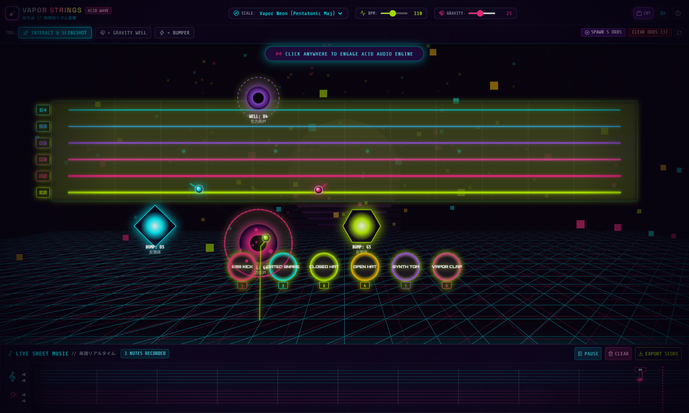
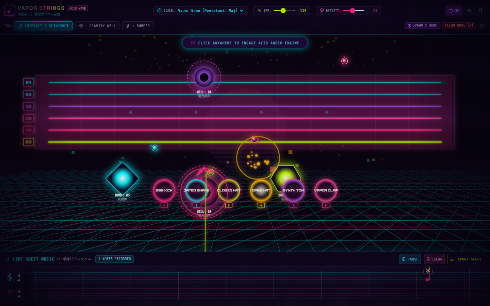
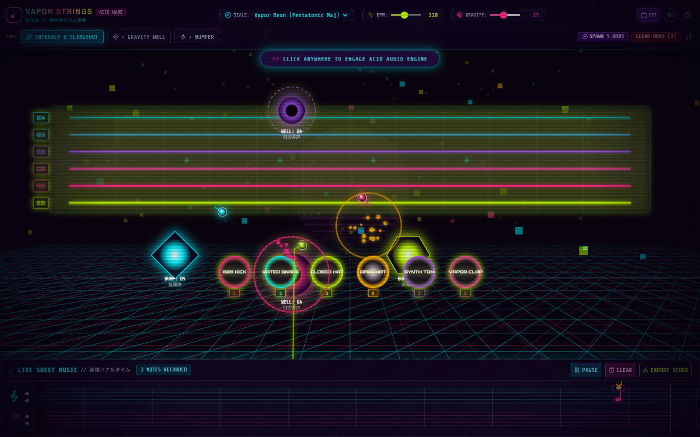

<div align="center">

# ＡＣＩＤ ＷＡＶＥ // ＶＡＰＯＲ ＳＴＲＩＮＧＳ
### ⚡ 物理的リズム音響 // PHYSICS-DRIVEN AUDIOVISUAL PLAYGROUND ⚡

<p align="center">
  <a href="https://acidwave-vaporstrings.vercel.app/" target="_blank">
    
  </a>
  <a href="https://acidwave-vaporstrings.vercel.app/" target="_blank">
    
  </a>
  
</p>

<p align="center">
  <a href="https://acidwave-vaporstrings.vercel.app/" target="_blank">
    
  </a>
</p>

<!-- Compact, sleek badges -->
<p align="center">
  
  
  
  
  
  
  
  
</p>

<p align="center">
  <strong>An interactive audio-visual instrument where physics meets musical synthesis. Play vibrating guitar strings, strike vintage 808 drums, curve moving light orbs with cosmic gravity wells, and transcribe every note in real time to live scrolling sheet music.</strong>
</p>

[🌐 Live App](https://acidwave-vaporstrings.vercel.app/) • [📸 Screenshots](#-screenshots) • [🌟 Core Features](#-core-features) • [🔬 Physics & Audio Math](#-physics--audio-engine) • [🎮 Controls](#-controls--hotkeys) • [🚀 Quick Start](#-quick-start)

</div>


---

## 📸 Screenshots

### 1. Main Interactive Playground & 3D Wireframe Horizon
> *Vibrating 6-string guitar fretboard, central gravity wells with gravitational lensing lines, geometric deflection bumpers, 808 drum pads, and 3D synthwave sun.*
<div align="center">
  
</div>

### 2. Live Sheet Music Staff & Dynamic Transcription
> *Real-time dual-clef music ribbon transcribing plucked notes, sharp accidentals (`♯`), middle C ledger lines, and percussion triggers as they happen.*
<div align="center">
  
</div>

### 3. Harmonic Deflection & Orbital Physics
> *Orbs slingshot across space, orbiting gravity wells and bouncing off bumpers to create generative polyrhythms.*
<div align="center">
  
</div>

---

## 🌟 Core Features

- **🎸 Karplus-Strong Guitar Strings**: 6 physical modeling acoustic/electric strings ($E_2, A_2, D_3, G_3, B_3, E_4$) with realistic delay-line feedback damping, body cavity resonance, and visual harmonic standing wave ripple physics.
- **🥁 Synthesized 808 / Linndrum Drum Engine**: Pure Web Audio synthesis for punchy 808 Sub Kick, Gated 80s Snare, Metallic Inharmonic Hi-Hats, Tuned Toms, and Vapor Claps (no audio file dependencies, zero latency).
- **🧲 Gravity Wells & Periapsis Chimes**: Real Newtonian attraction fields ($F = G \cdot M / r^2$) pull orbs into orbital trajectories. When an orb reaches closest approach (periapsis), a crystalline chime note is plucked in scale!
- **⚡ Deflection Bumpers**: Elastic geometric deflectors bounce moving orbs rhythmically with velocity kicks and expanding neon shockwaves.
- **🎼 Real-Time Scrolling Sheet Music**: Traditional 5-line staff with Treble & Bass Clefs, ledger lines, accidental sharps, and percussion symbols tracking every sound live with playhead scrubbing and JSON score export.
- **🌆 Three.js 3D Horizon & Outrun Aesthetics**: Infinite perspective wireframe neon grid, glowing striped retro sun reacting to bass frequencies, and toggleable CRT scanlines.
- **🎯 Slingshot Particle Launcher**: Click-and-drag aiming vector on empty space to launch glowing orbs with velocity proportional to pull distance.

---

## 🛠️ Tech Stack Overview

| Category | Tech | Purpose |
|---|---|---|
| **Core UI** |   | Concurrent rendering, type-safe physics vectors and audio events |
| **Tooling** |  | Lightning-fast build and hot module replacement (HMR) |
| **Styling** |  | Retro neon glows, glassmorphism panels, and CRT scanlines |
| **3D Graphics** |  | 3D perspective wireframe terrain, audio-reactive sun, and cosmic fog |
| **Sound Engine** |  | Karplus-Strong string synthesis, analog drums, master dynamics limiter |
| **Animation** |  | Shockwave physics and harmonic UI transitions |

---

## 🔬 Physics & Audio Engine

### 1. Karplus-Strong Physical String Modeling
Strings are synthesized physically using a noise burst fed into an in-loop delay buffer with a 1-pole lowpass damping filter and body resonance:

$$y[n] = \alpha \cdot \frac{x[n - D] + x[n - D - 1]}{2}$$

- $D = f_s / f_0$: Delay length tuned to string pitch.
- $\alpha \approx 0.988$: Decay factor modeling internal string friction and air resistance.
- Standing wave visualization: $y(x, t) = A \sin(\pi x / L) \cos(\omega t) e^{-\gamma t}$.

### 2. Keplerian Gravity Wells & Proximity Plucking
Orbs accelerate toward well centers following softened Newtonian gravitational pull:

$$\mathbf{a} = \frac{G \cdot M}{r^2 + \epsilon} \cdot \frac{\mathbf{r}}{\|\mathbf{r}\|}$$

When an orb sweeps through periapsis ($\mathbf{v} \cdot \mathbf{r} \approx 0$), the well detects the orbital event horizon crossing and excites a harmonic chime quantized to the current scale.

### 3. Deflection Bumpers & Polyrhythmic Loops
Bumpers deflect orbs using elastic circle collision resolution with restitution boost ($e = 1.25$):

$$\mathbf{v}' = \mathbf{v} - (1 + e)(\mathbf{v} \cdot \mathbf{n})\mathbf{n}$$

---

## 🎮 Controls & Hotkeys

| Action | Control | Description |
|---|---|---|
| **Strum Strings** | `Hover / Drag Mouse` | Swipe cursor across the guitar fretboard to pluck strings |
| **Strike Drums** | `Click Pad` or `Keys 1-6` | Trigger Kick (`1`), Snare (`2`), Closed Hat (`3`), Open Hat (`4`), Tom (`5`), Clap (`6`) |
| **Launch Orb** | `Click & Drag Canvas` | Pull back a slingshot vector on empty space to aim and launch orbs |
| **Move Shapes** | `Click & Drag Shape` | Reposition gravity wells and bumpers to customize rhythmic orbits |
| **Add Gravity Well** | `Tool: + GRAVITY WELL` | Click anywhere to place an attraction well |
| **Add Bumper** | `Tool: + BUMPER` | Click anywhere to place a deflection bumper |
| **Musical Scales** | `HUD Dropdown` | Switch between *Vapor Neon*, *Hirajoshi*, *Cyberpunk Dorian*, *Acid Lydian*, *Outrun Minor* |
| **BPM & Gravity** | `HUD Sliders` | Adjust rhythmic pulse tempo (70–160 BPM) and gravitational pull ($G$) |
| **CRT Filter** | `CRT Button` | Toggle retro phosphor CRT scanline overlay and vignette |
| **Sheet Music** | `Pause / Clear / Export` | Control the bottom notation ribbon and export session as JSON score |

---

## 🚀 Quick Start

### 🌐 Live Production Deployment
Experience the live application right in your browser (no installation needed):  
👉 **[https://acidwave-vaporstrings.vercel.app/](https://acidwave-vaporstrings.vercel.app/)**

### 💻 Local Development Setup

#### 1. Clone & Install
```bash
git clone <repository-url>
cd vapor-strings
npm install
```


### 2. Launch Development Server
```bash
npm run dev
```
Open **`http://localhost:5173/`** in your browser and click anywhere on screen to engage the Web Audio API engine!

### 3. Production Build
```bash
npm run build
npm run preview
```

---

## 📁 Directory Structure

```
vapor-strings/
├── docs/
│   ├── app-overview.png        # Full-interface overview screenshot
│   ├── live-transcription.png  # Sheet music notation and drum machine screenshot
│   └── hero-screenshot.png     # Gravity well and bumper deflection screenshot
├── src/
│   ├── audio/
│   │   ├── audioEngine.ts      # Web Audio context, compressor, delay & FFT analyser
│   │   ├── karplusStrong.ts    # Physical modeling guitar string synthesizer
│   │   ├── drumSynth.ts        # 808 kick, gated snare, hi-hats, toms & clap synth
│   │   └── scaleQuantizer.ts   # Scale definitions (Hirajoshi, Pentatonic, Dorian)
│   ├── physics/
│   │   ├── types.ts            # Type definitions for vectors, orbs, wells & bumpers
│   │   └── engine.ts           # 60 FPS physics loop, gravity, and collision engine
│   ├── components/
│   │   ├── ThreeBackground.tsx # Three.js 3D neon horizon & reactive synth sun
│   │   ├── InteractiveCanvas.tsx # 2D canvas with vibrating strings, shapes & orbs
│   │   ├── SheetMusicStaff.tsx # Live scrolling sheet music notation staff
│   │   └── ControlHud.tsx      # Floating top HUD with tool palette and sliders
│   ├── App.tsx                 # Root application coordinator
│   ├── index.css               # Tailwind CSS v4 directives & CRT scanline styling
│   └── main.tsx                # React application entry point
├── package.json
└── README.md
```

---

## 📜 License

Distributed under the **MIT License**.

<div align="center">
  <sub>Built with 💜 for fans of Acid Wave, Synthwave, and Creative Web Audio.</sub>
</div>
